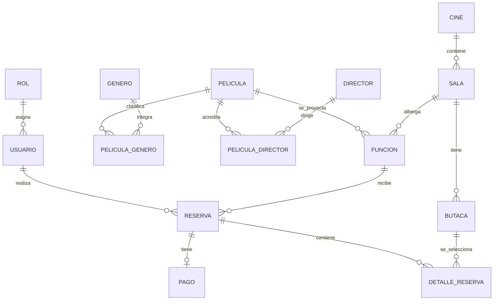
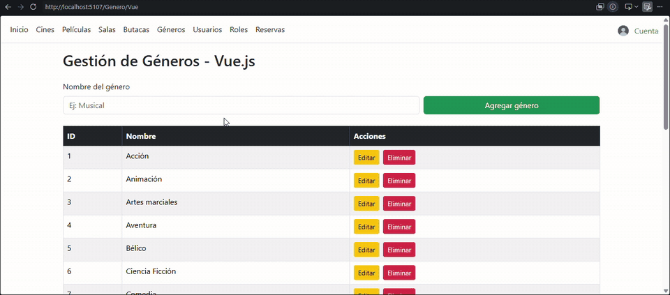
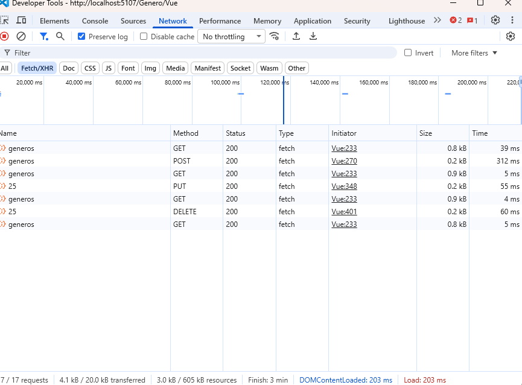

# 🎬 Cine_ProyectoFinal_Laboratorio2


Proyecto final de **Laboratorio II**: aplicación web desarrollada con **ASP.NET Core MVC** para administrar la cartelera, funciones, salas, usuarios, reservas de butacas y pagos de un cine.

> **Estado:** proyecto académico en desarrollo. Las funcionalidades descritas corresponden al código presente en la rama `main` al 4 de noviembre de 2026; pueden existir módulos en proceso de integración o prueba.

## 👥 Integrantes

- **Matías Martínez** — [GitHub](https://github.com/MatiasMartinez-22)
- **Alberto Daroni** — [GitHub](https://github.com/AlbertDaroni)
- **Jonatan Agüero** — [GitHub](https://github.com/davidjoni2401-sudo)

## 1. Narrativa del Proyecto y Descripción del Problema

### Datos del grupo

**Integrantes:** los tres integrantes y sus enlaces a GitHub se encuentran detallados al inicio de este README.

### Título / Nombre del Proyecto

**Sistema Web de Gestión de Cine y Reservas**

### Temática elegida

El proyecto consiste en el desarrollo de un sistema web para la gestión de un cine mediante una aplicación desarrollada con arquitectura MVC.

El sistema permitirá administrar cines, salas, butacas, películas, géneros, funciones, usuarios, reservas y pagos. Además, contará con diferentes roles de acceso, permitiendo distinguir las acciones que puede realizar un administrador, un empleado y un usuario.

### Descripción de la Problemática

La administración de un cine requiere manejar una gran cantidad de información relacionada con películas, salas, horarios de funciones, butacas, usuarios, reservas y pagos.

Cuando esta información se administra de forma manual o mediante distintos sistemas separados, pueden producirse diferentes problemas, como reservas duplicadas, errores en la asignación de butacas, dificultad para conocer la disponibilidad de las salas, inconvenientes en la organización de las funciones y falta de control sobre los pagos realizados.

También resulta necesario establecer distintos niveles de acceso dentro del sistema, ya que no todos los usuarios deben contar con los mismos permisos. Por ejemplo, un administrador debe poder gestionar la información general del sistema, mientras que un usuario común debe tener acceso principalmente a la consulta de películas, funciones y reservas.

Por este motivo, se propone desarrollar un sistema web que centralice toda la información necesaria para el funcionamiento del cine y facilite su administración.

### Propuesta de Solución

Se desarrollará una aplicación web utilizando el patrón MVC (Modelo-Vista-Controlador) para gestionar las distintas operaciones relacionadas con el funcionamiento de un cine.

El sistema contará con tres roles principales:

- **Administrador:** tendrá acceso a la gestión general del sistema, incluyendo usuarios, roles, cines, salas, butacas, películas, géneros, funciones, reservas y pagos.
- **Empleado:** podrá realizar tareas relacionadas con la gestión diaria del cine, como consultar funciones, administrar reservas, verificar disponibilidad de butacas y registrar pagos.
- **Usuario:** podrá consultar las películas y funciones disponibles, seleccionar una butaca y realizar una reserva.

El sistema permitirá registrar películas y clasificarlas según su género, organizar las salas pertenecientes a cada cine y administrar las butacas disponibles en cada una.

También permitirá crear funciones, indicando qué película se proyectará, en qué sala, qué día y a qué horario.

A partir de esas funciones, los usuarios podrán realizar reservas de butacas y registrar el pago correspondiente.

De esta manera, la aplicación permitirá centralizar la información del cine, reducir errores, mejorar la organización de las funciones y facilitar tanto la gestión interna como la experiencia de los usuarios.

## 2. Modelo de Datos y Diagrama Entidad-Relación

### Entidades principales (narrativa original)

**Usuario:** representa a las personas que utilizan el sistema. Contendrá los datos necesarios para identificar al usuario y permitir su acceso a la aplicación. Cada usuario tendrá asignado un rol.

**Rol:** representa los diferentes tipos de acceso dentro del sistema. Los roles principales serán Administrador, Empleado y Usuario. El rol determinará qué acciones puede realizar cada usuario.

**Cine:** representa cada establecimiento o sucursal registrada en el sistema. Un cine podrá contar con varias salas.

**Sala:** representa cada sala de proyección perteneciente a un cine. Cada sala tendrá una determinada capacidad y estará compuesta por diferentes butacas.

**Butaca:** representa cada asiento disponible dentro de una sala. Cada butaca pertenecerá a una sala determinada y podrá identificarse mediante fila y número.

**Película:** almacena la información correspondiente a las películas disponibles. Puede incluir datos como título, descripción, duración, clasificación, imagen y género.

**Género:** permite clasificar las películas según su tipo, por ejemplo: acción, comedia, terror, drama, ciencia ficción o animación. Un género podrá estar asociado a varias películas.

**Función:** representa una proyección de una película en una sala, en una fecha y horario determinados. Esta entidad permitirá organizar la cartelera del cine y relacionará la película, la sala, la fecha y el horario. Una misma película podrá tener varias funciones en distintos días, horarios o salas.

**Reserva:** representa la reserva realizada por un usuario para asistir a una función determinada. La reserva estará relacionada con un usuario, una función y las butacas seleccionadas. Esto permitirá controlar qué butacas ya fueron reservadas para cada función.

**Pago:** representa el registro del pago correspondiente a una reserva. Podrá almacenar información como importe, fecha del pago, medio de pago y estado del pago. Cada pago estará asociado a una reserva.

> **Actualización del modelo:** el proyecto también incorpora **Director** (responsable de dirigir películas) y **DetalleReserva** (butacas y precio de cada entrada dentro de una reserva). Los géneros y directores se vinculan con películas mediante relaciones muchos a muchos. La descripción original anterior refleja la propuesta académica; para los campos y relaciones efectivamente modelados, consultar el DER técnico de más abajo.

## 3. Descripción de las Relaciones

La narrativa original planteó las siguientes relaciones, ajustadas aquí a las entidades que finalmente se incorporaron:

- Un **Rol** puede estar asignado a varios **Usuarios**, pero cada usuario tendrá un solo rol.
- Un **Cine** puede tener varias **Salas**, pero cada sala pertenecerá a un solo cine.
- Una **Sala** puede tener varias **Butacas**, pero cada butaca pertenecerá a una única sala.
- Un **Género** puede estar asociado a varias **Películas** y una película puede tener varios géneros.
- Un **Director** puede dirigir varias **Películas** y una película puede tener varios directores.
- Una **Película** puede tener varias **Funciones**.
- Una **Sala** puede tener varias **Funciones** en distintos días y horarios.
- Cada **Función** corresponderá a una película y a una sala determinada.
- Un **Usuario** puede realizar varias **Reservas**.
- Una **Función** puede tener varias **Reservas**.
- Una **Butaca** puede aparecer en diferentes reservas siempre que correspondan a funciones distintas.
- Cada **Reserva** estará asociada a un usuario y una función, y sus butacas se registrarán a través de **DetalleReserva**.
- Una **Reserva** podrá tener asociado un **Pago**.

## 4. Resumen de Roles, Entidades y Vistas

**Roles:** Administrador, Empleado y Usuario.

**Entidades / tablas:** Usuario, Rol, Cine, Sala, Butaca, Película, Género, Director, Función, Reserva, DetalleReserva y Pago; además de las tablas intermedias `pelicula_genero` y `pelicula_director`.

**Vistas principales:** Inicio, Usuarios, Roles, Cines, Salas, Butacas, Películas, Géneros, Funciones, Reservas y Pagos, según las vistas y controladores disponibles en el proyecto. Las operaciones accesibles dependen de los permisos de cada rol.

---

## Documentación técnica y estado actual

## ✨ Funcionalidades presentes en el código

- **Cuentas:** registro, inicio y cierre de sesión, autenticación mediante cookies, permisos por roles y contraseñas hasheadas con `PasswordHasher<Usuario>`.
- **Usuarios:** consulta y administración por personal autorizado, roles y cambio de foto de perfil con validación de formato.
- **Cartelera:** consulta de cines, películas, salas y funciones; portadas de películas y relaciones con directores y géneros.
- **Gestión interna:** controladores para CRUD de cines, salas, películas, funciones, géneros, roles y pagos, con restricciones de acceso según el módulo.
- **Reservas:** selección de una o varias butacas para una función futura, cálculo del monto, consulta de reservas propias y cancelación bajo determinadas condiciones.
- **Disponibilidad:** verificación de butacas reservadas para cada función y uso de una transacción con bloqueo de la función durante la creación de la reserva.
- **Pagos:** registro, consulta, modificación y eliminación desde un módulo restringido al personal autorizado.
- **Navegación:** paginación de algunas listas y búsqueda de cines desde la gestión de salas.

**Alcance actual:** el controlador de butacas cuenta con consulta/listado; no se presenta como CRUD completo. La integración entre los módulos debe probarse en la base de datos configurada.

## 🧑‍💼 Roles

| Rol | Alcance general |
| --- | --- |
| **Administrador** | Gestión de usuarios y roles, además de las operaciones administrativas del cine. |
| **Empleado** | Acceso a varias operaciones de gestión de cines, salas, películas, funciones y pagos. |
| **Usuario** | Consulta de la cartelera, creación y consulta de sus reservas y modificación de su avatar. |

> Los permisos concretos dependen de los atributos `[Authorize]` y `[AllowAnonymous]` de cada controlador. No todas las acciones están disponibles para los tres roles.

## 🛠️ Tecnologías

- **C# y .NET 10**
- **ASP.NET Core MVC** y vistas Razor
- **Entity Framework Core 9** con proveedor **Pomelo.EntityFrameworkCore.MySql 9.0.0**
- **MySqlConnector 2.6.1** y **MySQL**
- **Bootstrap, HTML, CSS y JavaScript**
- **Autenticación por cookies** y `PasswordHasher<Usuario>`

## 🧩 Diagrama entidad-relación del modelo implementado

Entidades principales: **Rol, Usuario, Cine, Sala, Butaca, Película, Director, Género, Función, Reserva, DetalleReserva y Pago**.

Las películas pueden tener **varios géneros y varios directores** mediante las tablas intermedias `pelicula_genero` y `pelicula_director`. Una reserva pertenece a una función y admite varios detalles, cada uno asociado a una butaca.



**Regla de negocio clave:** la disponibilidad de una butaca se calcula por **función**, no de forma permanente para toda la sala. Una misma butaca puede reservarse para funciones distintas.

## 📂 Estructura del repositorio

```text
Cine_PF_Laboratorio2/
├── Controllers/               # MVC y endpoints API
├── Data/
│   └── BD_Context.cs          # EF Core y relaciones
├── DataBase/
│   ├── cine.sql               # Esquema SQL
│   └── datos.sql              # Datos de prueba
├── Models/                    # Entidades y viewmodels
├── Views/                     # Vistas MVC y módulo Géneros Vue
│   └── Genero/
│       └── Vue.cshtml
├── docs/
│   └── evidencias/
│       ├── crud-genero-vue-demo.gif
│       └── crud-genero-vue-network.png
├── wwwroot/                   # Archivos estáticos e imágenes
├── Program.cs
├── Proyecto Final.csproj
└── README.md
```

## 🚀 Instalación y ejecución local

### Requisitos

- SDK de **.NET 10**.
- Servidor **MySQL** accesible.
- Editor como Visual Studio o VS Code (opcional).

### Pasos

1. Clonar el repositorio:

   ```bash
   git clone https://github.com/AlbertDaroni/Cine_PF_Laboratorio2.git
   cd Cine_PF_Laboratorio2
   ```

2. Crear la base de datos en MySQL, por ejemplo:

   ```sql
   CREATE DATABASE cine CHARACTER SET utf8mb4 COLLATE utf8mb4_unicode_ci;
   ```

3. Seleccionar esa base de datos e importar **primero `DataBase/cine.sql`** (estructura) y **después `DataBase/datos.sql`** (datos de prueba opcionales), usando MySQL Workbench, DBeaver o un cliente equivalente.

4. Configurar `ConnectionStrings:DefaultConnection` en `appsettings.Development.json` o mediante secretos de usuario. Ejemplo de configuración **sin credenciales reales**:

   ```json
   {
     "ConnectionStrings": {
       "DefaultConnection": "Server=localhost;Port=3306;Database=cine;User=TU_USUARIO;Password=TU_CONTRASENA;"
     }
   }
   ```

   **Importante:** no subir contraseñas reales ni credenciales locales a GitHub. Se recomienda usar .NET User Secrets o variables de entorno.

5. Restaurar dependencias y ejecutar:

   ```bash
   dotnet restore
   dotnet run
   ```

6. Abrir en el navegador la dirección local indicada en la consola.

> **Nota:** la aplicación utiliza `ServerVersion.AutoDetect` de Pomelo, por lo que necesita conectarse a MySQL al iniciarse. Los archivos SQL son la vía de inicialización documentada aquí; no se presupone un flujo de migraciones automatizado.

## 🔐 Seguridad y reservas

- El inicio de sesión valida correo, DNI y contraseña.
- Los registros nuevos utilizan contraseñas hasheadas.
- Las acciones sensibles tienen restricciones por rol y, en distintas operaciones POST, validación antifalsificación.
- La creación de una reserva comprueba que la función esté disponible, que las butacas pertenezcan a la sala y que no existan reservas activas sobre esas butacas para la misma función.
- La cancelación de una reserva propia se impide si la función ya comenzó o si existe un pago activo pendiente de anulación.

Estas medidas describen la implementación actual; **no sustituyen pruebas de seguridad ni de concurrencia en un entorno real**.

## 📌 Estado del proyecto y próximos pasos

El repositorio contiene los módulos principales y datos de prueba, pero sigue siendo un trabajo académico en desarrollo. Antes de darlo por terminado, conviene completar pruebas de integración, revisar las pantallas y flujos de todos los roles, validar el circuito de pagos y reservas, y comprobar la compatibilidad del esquema SQL con los modelos y la configuración de Entity Framework Core.

## 📄 Contexto académico

**Proyecto Final — Laboratorio II**. Trabajo grupal orientado a aplicar el patrón MVC, el modelado de entidades y relaciones, la persistencia en base de datos relacional, la autenticación y la implementación de operaciones CRUD.


### CRUD de Géneros con Vue.js + AJAX

Se implementó un CRUD completo mediante Vue.js 3,
ASP.NET Core MVC y solicitudes AJAX con fetch.

Operaciones implementadas:
- GET: listado de géneros.
- POST: creación de géneros.
- PUT: modificación de géneros.
- DELETE: eliminación de géneros.

Todas las operaciones se realizan sin recargar la página.

## . Matriz de evidencias de requerimientos mínimos

Esta matriz es una **evaluación del estado actual**, no una certificación de pruebas que todavía no se realizaron. Los enlaces al código apuntan a la rama `main` y pueden modificarse con nuevos commits.

| Requerimiento mínimo | Estado | Enlace al código / implementación | Evidencia / pendiente |
| --- | --- | --- | --- |
| **1. ≥6 entidades, relación 1:N y N:M** | ✅ Cumplido | [BD_Context.cs](Data/BD_Context.cs), [Models](Models/) | DER Mermaid de la sección 3 y tablas de `DataBase/cine.sql`. |
| **2. Login, Logout, Roles y Avatar** | 🟡 Parcial | [CuentaController.cs](Controllers/CuentaController.cs), [UsuarioController.cs](Controllers/UsuarioController.cs), [Program.cs](Program.cs) | Login y roles implementados. **Pendiente:** edición segura de avatar propio por cada usuario y capturas de prueba de los tres roles. |
| **3. Manejo adicional de imágenes** | 🟡 Implementado; evidencia pendiente | [PeliculaController.cs](Controllers/PeliculaController.cs), [Portadas](wwwroot/uploads/portada/) | Existe carga de portadas, separada del avatar. **Pendiente:** captura/GIF de la carga de una portada nueva. |
| **4. CRUD completo Vue.js + AJAX/JSON** | ✅ Cumplido y probado | [Vista Vue.cshtml](Views/Genero/Vue.cshtml), [GeneroApiController.cs](Controllers/GeneroApiController.cs) | [GIF del CRUD](docs/evidencias/crud-genero-vue-demo.gif) y [captura Network GET/POST/PUT/DELETE](docs/evidencias/crud-genero-vue-network.png). |
| **5. Paginación por servidor** | 🟡 Parcial | [SalaController.cs](Controllers/SalaController.cs), [ReservaController.cs](Controllers/ReservaController.cs) | Implementada con `Skip/Take` en Salas y Reservas. **Pendiente:** Butacas, Usuarios, Películas y otros listados principales; captura `pagina=2` y respuesta paginada. |
| **6. Búsqueda asíncrona de entidades relacionadas** | 🟡 Implementado; pruebas/evidencia pendientes | [SalaController.cs](Controllers/SalaController.cs), [FuncionController.cs](Controllers/FuncionController.cs), [PagoController.cs](Controllers/PagoController.cs), [UsuarioController.cs](Controllers/UsuarioController.cs), [Crear Butaca.cshtml](Views/Butaca/Crear.cshtml) | Hay endpoints de búsqueda limitada y formularios que usan `fetch()`. **Pendiente:** verificar todos los formularios relevantes y capturar GIF de una búsqueda AJAX. |
| **7. Web API REST autenticada con JWT** | 🟡 Implementado; pruebas pendientes | [AutenticadorController.cs](Controllers/AutenticadorController.cs), [Program.cs](Program.cs) | `POST /api/Autenticador/login` y `GET /api/Autenticador/mis-datos`. **Pendiente:** probar Bearer válido, ausente e inválido y subir colección de Postman/Bruno/Insomnia. |

**Criterio:** ✅ indica cumplimiento corroborado por código y/o pruebas realizadas; 🟡 indica desarrollo existente con requisitos o evidencias todavía pendientes. Los requisitos parciales **no se consideran completados al 100 %**.

### Evidencia visual — CRUD de Géneros

**Demostración de alta, modificación y baja sin recargar:**



**Inspector de red — GET, POST, PUT y DELETE con HTTP 200:**



**Reglas validadas:** rechazo de géneros duplicados y bloqueo de eliminación de géneros asociados a películas.

## 6. API y endpoints principales

### CRUD AJAX de Géneros (sesión web)

| Método | Ruta | Función | Autenticación |
| --- | --- | --- | --- |
| `GET` | `/api/generos` | Listar | Cookies; Administrador o Empleado |
| `POST` | `/api/generos` | Crear | Cookies + token antifalsificación |
| `PUT` | `/api/generos/{id}` | Editar | Cookies + token antifalsificación |
| `DELETE` | `/api/generos/{id}` | Eliminar | Cookies + token antifalsificación |

### API JWT (implementada; pruebas pendientes)

| Método | Ruta | Función |
| --- | --- | --- |
| `POST` | `/api/Autenticador/login` | Recibe correo y contraseña y, con credenciales válidas, entrega JWT. |
| `GET` | `/api/Autenticador/mis-datos` | Requiere cabecera `Authorization: Bearer <token>` y devuelve datos autenticados. |

**Aclaración:** el CRUD Vue utiliza la sesión web y un token antifalsificación; **no consume JWT**. Por eso, para promoción corresponde adjuntar una colección exportada de pruebas de la API JWT.


**Repositorio:** [AlbertDaroni/Cine_PF_Laboratorio2](https://github.com/AlbertDaroni/Cine_PF_Laboratorio2)
